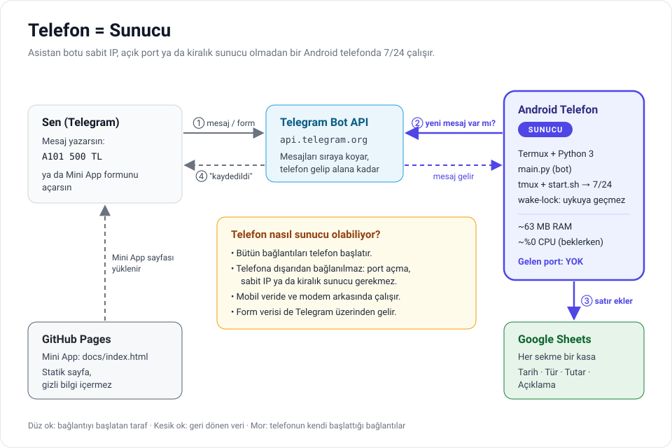
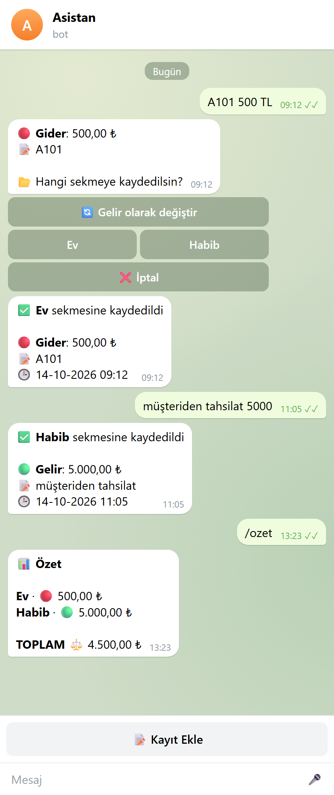
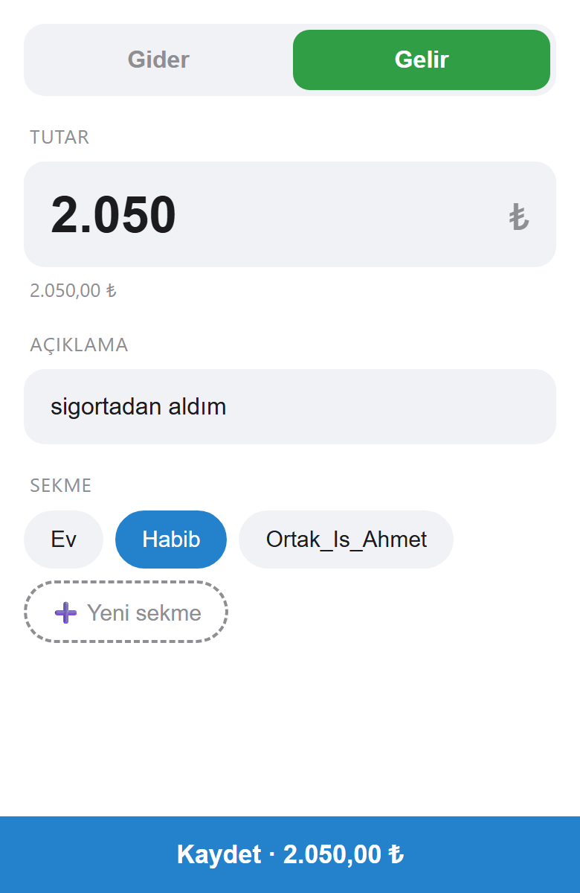
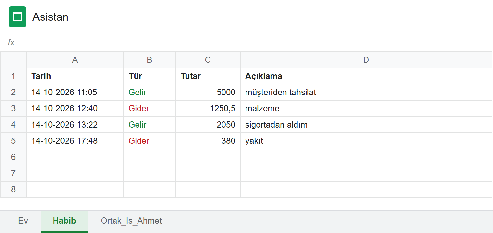

# Asistan — Telefonda Çalışan Kişisel Muhasebe Botu

Telegram'dan `A101 500 TL` yazarsın, kayıt saniyeler içinde Google Sheets'e düşer.
Bot **kendi Android telefonunda** çalışır: sunucu kiralamak, port açmak ya da sabit IP almak gerekmez.

<p align="center">
  
</p>

📄 Aynı tanıtımın PDF hâli: [Asistan-Tanitim.pdf](Asistan-Tanitim.pdf) · 🛠️ Adım adım kurulum: [KURULUM.md](KURULUM.md)

---

## Telefon nasıl sunucu oluyor?

Klasik bir bot sunucusu, internetten gelen bağlantıları dinler; bunun için sabit bir IP adresi ve açık bir port gerekir. Ev internetinde ya da mobil veride ikisi de yoktur. Asistan bu sorunu **bağlantının yönünü tersine çevirerek** çözer:

1. **Telefon sorar, Telegram cevaplar.** Bot, Telegram'a sürekli "yeni mesaj var mı?" diye sorar (*long polling*). Mesaj yoksa Telegram bağlantıyı birkaç saniye açık tutar; mesaj gelir gelmez aynı bağlantıdan cevap verir. Yani gecikme olmaz, ama bağlantıyı başlatan **her zaman telefondur**.
2. **Telefona dışarıdan hiç bağlanılmaz.** Bütün trafik telefondan dışarıya giden HTTPS isteğidir (Telegram ve Google'a). Modem, operatör NAT'ı ya da güvenlik duvarı bu yüzden engel olmaz; Wi-Fi ile mobil veri arasında geçiş yapılsa bile bot bağlantıyı kendisi yeniler.
3. **Mini App bile sunucu istemez.** Form sayfası statik bir HTML dosyasıdır ve GitHub Pages'te ücretsiz yayınlanır. Doldurulan form telefona doğrudan gitmez; Telegram'ın `sendData` mekanizmasıyla sohbete bir mesaj olarak düşer ve bot onu diğer mesajlar gibi alır.
4. **7/24 ayakta kalır.** Bot Termux içinde `tmux` oturumunda çalışır. `start.sh` çökerse 10 saniyede yeniden başlatır, `termux-wake-lock` telefonun işlemciyi uyutmasını engeller. Açılışta internet yoksa bot kapanmaz, bağlanana kadar dener.

### Telefona yükü ne kadar?

Gerçek telefonda ölçülen değerler:

| Kaynak | Kullanım |
|---|---|
| RAM | **~63 MB** (4-8 GB'lık telefonda %1-1,5) |
| İşlemci | Beklerken **~%0**; mesaj gelince bir saniyeden kısa |
| İnternet | Günde ~10-15 MB (Telegram'a periyodik "var mı?" soruları) |
| Depolama | Kurulum ~150-200 MB; log dosyası en fazla 4 MB |

---

## Ekran görüntüleri

<table>
  <tr>
    <td align="center" width="50%"><br><sub>Yazarak kayıt, tür değiştirme ve özet</sub></td>
    <td align="center" width="50%"><br><sub>Telegram içinde açılan Mini App formu</sub></td>
  </tr>
</table>

<p align="center">
  <br>
  <sub>Her sekme ayrı bir kasa: Tarih · Tür · Tutar · Açıklama</sub>
</p>

---

## Özellikler

- **Serbest metinle kayıt:** `A101 500 TL`, `Market 1.250,50`, `2 adet ampul 150` — tutar ve açıklama otomatik ayrılır (Türkçe ve İngilizce sayı biçimleri).
- **Gelir/gider tahmini:** `+15000 maaş`, `gelir kira 8000` ya da *maaş, tahsilat, müşteriden, sattım* gibi kelimeler gelir sayılır. Tahmin yanlışsa kaydetmeden önce **🔄** ile değiştirilir.
- **Dinamik sekmeler:** `/yenisayfa Borclar` yeni bir sekme açar, başlıkları yazar ve kalın yapar. Sekmeler butonlarda anında görünür.
- **Sesli kayıt:** Sesli mesaj ("A101'e beş yüz lira") Gemini API ile metne çevrilir, sonra yazılı mesajla aynı akıştan geçer. Ses telefonda işlenmez; ücretsiz anahtar kart istemez.
- **Mini App formu:** Gider/Gelir, tutar, açıklama ve sekme seçimi; formdan yeni sekme de açılabilir.
- **Özet:** `/ozet` her sekmenin gelir, gider ve net toplamını verir.
- **Dayanıklılık:** Ağ ya da Google kota hatalarında otomatik yeniden deneme, anlaşılır Türkçe hata mesajları, dönen log dosyası.

## Güvenlik

- **Tek kullanıcı:** Her mesaj işlenmeden önce gönderenin kimliği kontrol edilir; `ALLOWED_USER_ID` dışındaki kişilere bot hiç yanıt vermez, deneme log'a yazılır.
- **Gizli bilgiler depoda yok:** Bot token'ı ve kullanıcı/tablo kimlikleri `config.py`'de, Google anahtarı `credentials.json`'da durur. İkisi de `.gitignore`'dadır; depoda yalnızca boş şablon (`config.example.py`) vardır.
- **Mini App gizli bilgi taşımaz:** Sayfa herkese açıktır ama içinde anahtar ya da token yoktur. Gelen form verisi bot tarafında yeniden doğrulanır (tür, tutar aralığı, sekme adı uzunluğu).
- **En az yetki:** Google Service Account yalnızca kendisiyle paylaşılan tabloya erişebilir.
- **Sesli mesajlar:** Metne çevrilmek üzere Gemini API'ye gider. Ücretsiz katmanda Google bu içeriği ürün geliştirmede kullanabilir; sesli notlarda hassas bilgi söylemeyin.

## Proje yapısı

```
asistan-app/
├── main.py              # Bot: ayrıştırıcı, Sheets katmanı, Telegram handler'ları
├── config.example.py    # Ayar şablonu → config.py olarak kopyalanır (git'e girmez)
├── requirements.txt     # python-telegram-bot, gspread, google-auth, requests
├── start.sh             # Çökünce yeniden başlatan döngü + wake-lock
├── index.html           # Mini App (GitHub Pages kök dizinden yayınlar)
├── assets/              # README görselleri
├── KURULUM.md           # Termux, Google Cloud ve Mini App kurulumu
└── Asistan-Tanitim.pdf  # Bu tanıtımın PDF hâli
```

## Hızlı başlangıç (Termux)

```bash
pkg install -y python git tmux python-cryptography
git clone https://github.com/fazliddin-hamdam/asistan-app.git ~/Asistan && cd ~/Asistan
pip install -r requirements.txt
cp config.example.py config.py && nano config.py   # token, kullanıcı ID, tablo ID
# credentials.json dosyasını bu klasöre koyun, sonra:
tmux new -s bot ./start.sh
```

Google Cloud anahtarının alınması ve tablonun paylaşılması dahil bütün adımlar [KURULUM.md](KURULUM.md)'de.

## Sınırlamalar

- Bot telefonda çalıştığı için telefon **açık ve internete bağlı** olmalı.
- Sekmesi seçilmeyi bekleyen kayıtlar bellekte tutulur; bot yeniden başlarsa o mesajın tekrar gönderilmesi gerekir.
- Mini App'teki sekme listesi buton adresine gömülüdür; Sheets'te elle sekme eklenirse `/start` listeyi yeniler.

## Teknolojiler

Python 3 · [python-telegram-bot](https://python-telegram-bot.org/) (async) · [gspread](https://docs.gspread.org/) · Google Sheets API · Telegram Mini Apps · GitHub Pages · Termux
